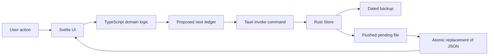

# How the project is made

This is a code-reading guide. For installing prerequisites and building a clean checkout, use [SETUP.md](SETUP.md).

## Start with these files

Read in this order:

1. `src/lib/model.ts` — the JSON contracts and accounting rules.
2. `src/App.svelte` — screens, form state, derived views, and user actions.
3. `src-tauri/src/main.rs` — the native commands called by the UI and application startup.
4. `src-tauri/src/storage.rs` — what a save actually does on disk.
5. A feature module such as `src/lib/tags.ts` or `src/components/ReceiptScanner.svelte`.

Bundled code in `public/ocr/core` and `public/ocr/worker.min.js` is third-party generated code. Start with our small `receipt-ocr.ts` wrapper rather than attempting to read those bundles.

## The two halves

The **frontend** is Svelte/TypeScript: it renders the UI, holds temporary form state, derives totals, and proposes ledger changes. The **backend** is Rust inside Tauri: it owns the filesystem, validates JSON, controls concurrent writes, makes backups, and commits saves.

There is no application server or database. Vite is a development tool, not a runtime dependency of the portable executable.

## Startup

1. Rust `main.rs` locates the executable and chooses its adjacent `data` directory.
2. `Store::open` acquires the OS lock, loads/recovers the ledger, and migrates older supported data if necessary.
3. Tauri creates the WebView and serves embedded frontend assets.
4. `src/main.ts` mounts `App.svelte` into the HTML root.
5. `App.svelte` calls `invoke('load')` from its `onMount` handler.
6. The result supplies the committed ledger, settings, data path, and any recovery notice.

Browser-only preview uses an empty in-memory ledger and cannot exercise native persistence. The `--ocr-self-test` diagnostic mode uses a separate `self-test-data` directory and only bundled synthetic inputs.

## Data model

`model.ts` defines the persisted TypeScript interfaces. Their property names are also the JSON file format; changing them requires reviewing Rust validation and migration.

| Value                  | Meaning                                                                |
| ---------------------- | ---------------------------------------------------------------------- |
| `Ledger.schemaVersion` | Stored structure version; current version is 2                         |
| `Ledger.revision`      | Concurrency token checked/advanced by native saves                     |
| `transactions`         | Stable-ID entries; current totals derive from these                    |
| `tags`                 | Central registry of stable IDs and display names                       |
| `deletedSourceIds`     | Tombstones preventing deleted imported rows from returning on reimport |
| `imports`              | Historical reconciliation snapshots, not current accounting totals     |

Each transaction has two independent time fields: nullable purchase `date` and required reporting `month`. `amount` is nullable, nonnegative, rounded whole yen; `type` decides whether it contributes to expenses, salary, income, or refunds.

`category` describes the purchase. `tagIds` connects it to collections. `flags` records data-quality issues. Those are three separate concepts.

Workbook `source` preserves original cells/formulas and remains historical after edits. Receipt `receipt` metadata records only origin, input kind, engine, and review time. It does not contain a photo or complete OCR text.

## Follow one manual save

In `App.svelte`, the form submits to `saveManualEntry`:

1. Validate the description, reporting month, optional date, and amount expression.
2. Use `calculate`/`yen` from `arithmetic.ts` to preserve exact rounding.
3. Resolve draft tag names to registry IDs with `resolveTagNames`.
4. Create/update a transaction inside a cloned proposed ledger.
5. Pass that ledger to `commitLedger`.

`commitLedger` calls `invoke('save', { ledger, expected: ledger.revision })`. The native command delegates to `Store::save`. Only after native success does the frontend replace its committed ledger and retain the previous snapshot for Undo. Failed saves report an error and keep the editable draft.

The Svelte `$:` blocks derive monthly/history filters, current totals, descriptions, and suggestions from committed state. They do not write files. This separation is why changing a filter cannot change accounting data.

## Amount expressions

`arithmetic.ts` implements a recursive-descent parser with normal arithmetic precedence. It recognizes numbers, unary signs, parentheses, and `+ - * /`; no identifier/function syntax or arbitrary code execution is allowed.

Intermediate arithmetic uses reduced BigInt fractions. `yen` rounds directly from that fraction, including negative halves away from zero. `calculate` returns a high-precision decimal for previews/import metadata. Do not replace the rounding path with JavaScript floating-point arithmetic or `Math.round`.

`totals` in `model.ts` sums rounded transactions and counts unknown amounts separately. Savings = salary + income + refunds − expenses. Tag spending totals keep other income/salary separate from expenses − refunds.

## Native persistence and recovery

`main.rs` exposes these commands:

| Command                | Responsibility                                              |
| ---------------------- | ----------------------------------------------------------- |
| `load`                 | Read initial UI state                                       |
| `save`                 | Commit a proposed ledger with an expected revision          |
| `backups`, `backup`    | List/create committed ledger snapshots                      |
| `restore`              | Validate/migrate a backup, then commit it as a new revision |
| `save_settings`        | Back up and replace settings                                |
| `export_csv`           | Write a UTF-8 CSV export beside the ledger                  |
| `finish_ocr_self_test` | Diagnostic-only synthetic result output and exit            |

`AppState.store` is a mutex-protected `Store`. Its held file handle keeps the data-folder OS lock alive. The mutex serializes commands; the OS lock prevents cooperating app instances from using the same folder simultaneously.

`Store::save` validates the proposed JSON, checks the expected revision, compares the disk ledger with memory, backs up the current committed ledger, writes/flushed a sibling pending file, and atomically replaces the target. It publishes the new in-memory ledger after replacement succeeds.

On restart, a valid committed file wins over an interrupted pending file. Damaged committed data can recover from a valid backup while preserving the damaged file. An interrupted first save can recover from a valid pending file. Unsupported future schemas are refused rather than overwritten. These are recovery rules, not a substitute for backups on another disk.

`migration.rs` contains a pure schema upgrade. It maps legacy trip labels to central tag IDs deterministically and preserves the remaining fields. File writes, revision changes, and migration backups remain the storage layer's responsibility.

## Receipt scanning

Read these files in sequence:

1. `ReceiptScanner.svelte` — capture/review state and explicit confirmation.
2. `receipt-images.ts` — image limits, encoded-dimension checks, decoding/rotation/resizing, and capture.
3. `receipt-ocr.ts` — a disposable local Tesseract worker.
4. `receipt-parser.ts` — pure date/total candidate extraction from recognized text.
5. `receipt-pages.ts` — merges independent photo results, deduplicates candidate values, and leaves conflicts unresolved.

The scanner keeps up to six photos in memory with stable temporary IDs and object URLs. Selection does not replace the photo collection; rotation updates one photo, removal invalidates extracted fields, and close revokes every URL. OCR runs sequentially to bound worker memory; cancellation invalidates the entire run. A failed photo adds a warning while other results remain reviewable. Date-only and total-only photos can produce one draft. Photo totals are never summed. Mixed camera/file sessions use `receipt.input = mixed`, accepted by native validation without changing the ledger structure. 5. `saveReceipt` in `App.svelte` — construct a reviewed transaction and use `commitLedger`.

The scanner progresses through choose, camera, image, recognizing, and review phases. Camera access starts only from a deliberate action. Captured pixels are not mirrored, and video tracks stop after capture/close. `CameraControls.svelte` and `camera-controls.ts` inspect per-track capabilities only after Start camera. Supported focus/exposure/range controls use optional constraints and read back settings. Spot focus is offered only when points-of-interest settings are exposed, with clicks mapped through video letterboxing. Unsupported controls do not simulate a focus effect.

The worker loads local resources via `public/ocr/offline-worker.js`; remote resource loads are rejected. OCR does not create transactions. Recognition results populate a review draft, and the user must explicitly confirm it.

Cancellation has two protections: abort/terminate worker work, and increment a generation token so stale results cannot populate a newer draft. During initialization, the worker handle may arrive late; it is terminated without receiving an image if canceled. Images/object URLs and complete OCR text remain transient, not ledger fields.

`receipt-parser.ts` is intentionally independent of the camera/OCR engine so total/tender/change/tax ambiguity can be tested with text fixtures. A valid date can still be an OCR mistake; manual review remains required.

## Tags and collections

`TagSelector.svelte` holds draft names. `tag-names.ts` defines trimming/normalization and comparison keys. `tags.ts` resolves names, matches membership, and builds immutable proposed ledgers for bulk changes, rename, merge, or removal.

Registry IDs remain stable when names change. A rename collision requires explicit merge consent and combines membership without duplicate references. Removing a tag removes associations, never transactions or amounts.

The UI filters the transaction array once for any/all selected tags. It does not concatenate one result per tag, which would double-count entries belonging to several selected tags. Bulk operations use explicitly selected transaction IDs and commit coherently once.

`csv.ts` serializes tag IDs/names as JSON arrays within escaped CSV cells, preserving commas/quotes in names. Potential spreadsheet-formula text is prefixed for export.

## Workbook import

`importer.ts` has four phases:

1. Decode relevant ZIP/XML parts into source cells.
2. Validate the supported fixed block layout before treating cells as entries.
3. Normalize transaction values while preserving raw provenance and uncertainty flags.
4. Reconcile each reporting block independently.

`planImport` is read-only. It separates fresh rows, existing/deleted rows, and source conflicts using stable source-cell IDs. The workbook hash identifies its revision; it is not the transaction ID. Reimport never silently overwrites a local edit or removes a deletion tombstone.

The importer is specialized. Extending it to another layout or additional blocks needs explicit validation/reconciliation changes, not just changing a date label. Public tests generate fictional workbooks in memory; personal workbooks and original historical test expectations remain ignored locally.

## Repository and generated files

- `src` and `src-tauri/src` are our application logic.
- `scripts` contains formatting, OCR preparation, checks, fixture generation, and packaging helpers.
- `public/receipt-fixtures` and application icons are generated safe assets.
- `public/ocr` contains vendored runtime assets/licenses plus our local-only worker guard.
- `dist`, native `target`, `node_modules`, local toolchains, working data, private reports/photos, and release archives are ignored.

The formatting script deliberately enumerates first-party files and respects `.prettierignore`. It must not rewrite vendor code, private fixtures, or financial JSON. Rust uses rustfmt; Python utilities use Black; PowerShell scripts use explicit blocks and named steps.

## Where to make a change

| Desired change                  | Start here                                       | Relevant verification                                                  |
| ------------------------------- | ------------------------------------------------ | ---------------------------------------------------------------------- |
| Entry form or screen layout     | `App.svelte`                                     | Frontend build and headless UI checks                                  |
| Receipt capture/review controls | `ReceiptScanner.svelte`, `receipt-images.ts`     | Headless lifecycle tests and a user-run physical-camera check          |
| Date/total recognition rules    | `receipt-parser.ts`                              | Text fixtures and representative opt-in image checks                   |
| Rounding or amount syntax       | `arithmetic.ts`                                  | Exact-boundary tests and accounting/import regressions                 |
| Tag behavior                    | `tags.ts`, `TagSelector.svelte`                  | Membership/merge/totals tests                                          |
| Persisted JSON structure        | `model.ts`, `migration.rs`, `storage.rs`         | Versioned migration, old-backup restore, and restart tests             |
| Build/distribution              | `package.json`, Tauri config, PowerShell scripts | Build in an isolated folder; inspect the distribution for private data |

Use the existing baseline Git commit to review behavior-preserving refactors. Formatting alone should not change financial results, source fingerprints, or the receipt-review requirement.

### Photo crops

`ReceiptCropper.svelte` displays a selection surface aligned to the actual image content, excluding letterboxing. Pointer capture supports dragging in either direction; percentage fields offer a keyboard alternative. `cropPixels` validates normalized bounds and maps them to source pixels, then `cropImage` draws a new in-memory PNG. Receipt/date crops keep the selected pixels without padding. Only amount-only crops use the separately tested 20-pixel white margin: adding white padding to grey-paper date images was found to disrupt recognition.

`ReceiptScanner.svelte` retains each photo's original prepared Blob and its edited Blob, counting unique Blob references toward the session limit. Applying an edit invalidates old OCR fields, while cancelling the crop preserves the draft. Original-file pixels on disk are never changed. Restoring a photo drops its edit and resets the OCR mode. Originals, edited Blobs, and object URLs are released when the scanner closes.

A photo's transient OCR mode is either `receipt` (Japanese + English, block segmentation) or `amount` (English, single-line segmentation). Both use the same bundled models and worker lifecycle. `selectReceiptAmount` is shared by single-image parsing and multi-photo merging. It chooses one distinct labelled total when available; otherwise it fills one distinct unlabelled candidate. Conflicting values stay null. Repeated values across photos are deduplicated by amount, never summed. Unlabelled suggestions retain a review warning. This fills the draft without saving or marking it reviewed. OCR mode and image data are not added to persisted receipt metadata.

### Clipboard images

`receipt-clipboard.ts` extracts only image file items from a paste event, using `files` as a fallback without duplicating representations. Explicit clipboard reads choose one PNG/JPEG representation per item and never read text/HTML or fetch URLs. `ReceiptScanner.svelte` owns the paste listener only while mounted. Ctrl+V follows the event path; the button invokes `navigator.clipboard.read()` only on a deliberate click.

Clipboard images enter `setImage` through the same validation, preparation, session memory limits, crop and review path as files. Paste is blocked during recognition, cropping, saving or image preparation. Generation checks discard results arriving after close/cancel. The clipboard is never written or polled. Native receipt validation permits `clipboard` alongside existing input kinds without adding image payload fields or changing the JSON structure.
